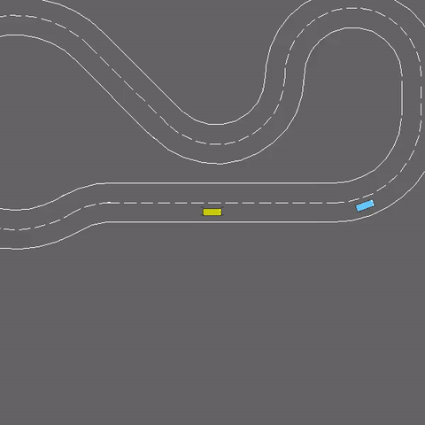

# Autonomous Racing with Deep Reinforcement Learning

An autonomous racing system built with **Gymnasium**, **Highway-Env**, and **Stable-Baselines3**. The project trains an autonomous racing agent to navigate a challenging racetrack with dynamic traffic, learning smooth steering and overtaking maneuvers using Deep Reinforcement Learning.

---

## Demo Preview

<p align="center">
  
</p>

*Trained SAC agent navigating the track with dynamic traffic and smooth steering control.*

[autonomous_racer_sac-episode-0.mp4](videos/autonomous_racer_sac-episode-0.mp4)

---

## Overview

This project implements an end-to-end reinforcement learning pipeline designed to achieve fast, safe, and stable lap times on the `racetrack-v0` circuit.

### Key Highlights
- **Environment:** Built on `highway-env`'s `racetrack-v0`, featuring multi-lane race circuits with multiple competing vehicles.
- **State Representation:** 2D local Occupancy Grid (`presence`, `on_road`) aligned to vehicle axes, giving the agent spatial awareness of track boundaries and nearby vehicles.
- **Action Space:** Continuous lateral control (steering angle), paired with automatic cruise control handling longitudinal acceleration.
- **Smooth Driving Reward Shaping (`SmoothRacerWrapper`):** Standard RL agents often exhibit high-frequency steering jitter. We implement a custom wrapper that penalizes steering jerk (`|steering_t - steering_{t-1}|`) to encourage fluid, natural racing trajectories.
- **Algorithms:** Supports both **Soft Actor-Critic (SAC)** (default, off-policy continuous control) and **Proximal Policy Optimization (PPO)**.
- **Evaluation & Video Capture:** Seamless evaluation pipeline with `RecordVideo` wrapper to produce high-resolution MP4 recordings of trained agents.

---

## Repository Structure

```text
autonomous-racing-rl/
├── env_wrapper.py       # Custom Gym environment wrapper and racetrack config
├── train.py             # RL training pipeline (SAC & PPO) with evaluation callbacks
├── evaluate_video.py    # Evaluation and video recording script
├── requirements.txt     # Python dependencies
├── .gitignore           # Git ignore rules for checkpoints, logs, and cache
├── videos/              # Recorded evaluation runs & visual previews
│   ├── autonomous_racer_sac-episode-0.mp4
│   └── racer_demo.gif
├── models/              # Saved model checkpoints (ignored by Git)
└── logs/                # TensorBoard logs and evaluation stats (ignored by Git)
```

---

## Getting Started

### 1. Prerequisites & Installation

Clone the repository and set up a Python virtual environment:

```bash
# Clone the repository
git clone <repo-url>
cd autonomous-racing-rl

# Create and activate virtual environment
python -m venv venv

# On Windows:
.\venv\Scripts\activate

# On Linux/macOS:
source venv/bin/activate

# Install dependencies
pip install -r requirements.txt
```

### 2. Training the Agent

Train an agent using SAC (default) or PPO:

```bash
# Train using Soft Actor-Critic (SAC) for 50,000 steps
python train.py --algo sac --steps 50000

# Or train using PPO
python train.py --algo ppo --steps 50000
```

During training:
- Best model checkpoints are automatically saved to `./models/{algo}_best/`.
- TensorBoard metrics are logged to `./logs/tensorboard/`.

You can view training curves with:
```bash
tensorboard --logdir logs/tensorboard/
```

### 3. Evaluating and Recording Video

Evaluate the best trained model and export an episode video:

```bash
python evaluate_video.py
```

The resulting video will be saved to `./videos/autonomous_racer_sac-episode-0.mp4`.
